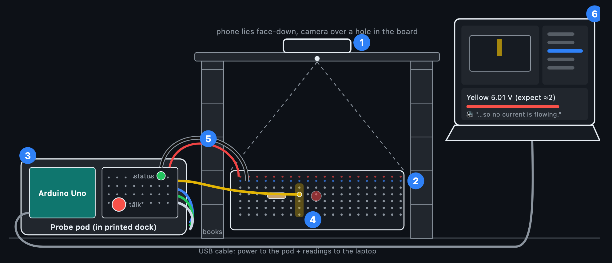
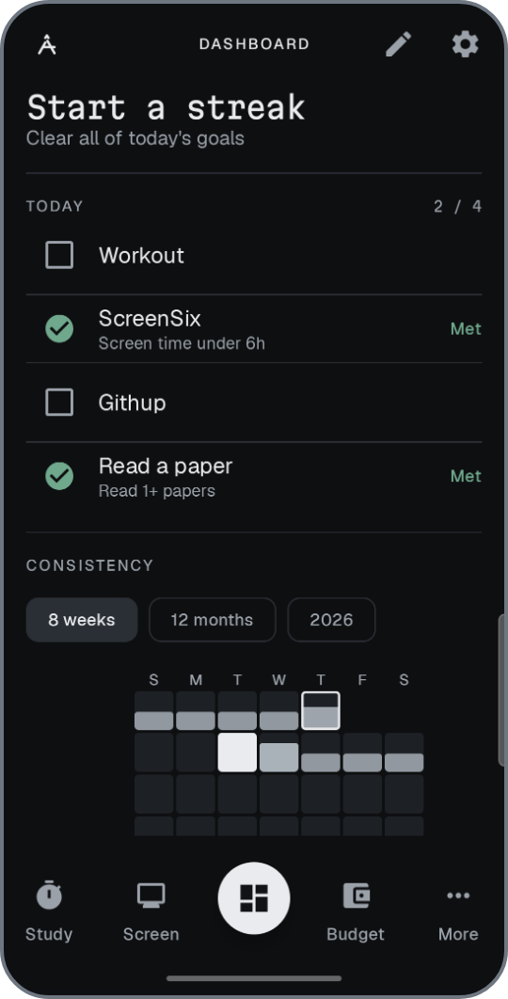

  

**[Portfolio](https://aadityad.dev)** · **[Résumé](https://aadityad.dev/Aaditya_Desai_Portfolio_Resume.pdf)** · **[LinkedIn](https://www.linkedin.com/in/aaditya-desai-12d)** · **[Email](mailto:aaditya.d.desai@gmail.com)** · **[Devpost](https://devpost.com/aadityad12)**

I'm Aadi. I build at every layer, from bare-metal firmware and a JIT compiler up to AI agents and an Android app I use every day, and I like work I can measure. This page is the short tour. Each project links to a repo with the full write-up, the numbers, and what still doesn't work.

### Where to look

| For a role in | Start with | What you'll find |
| :-- | :-- | :-- |
| Systems and compilers | [Rung](#rung) | C++20, a hand-written ARM64 JIT |
| Embedded and firmware | [Alta](#alta)&nbsp;·&nbsp;[VisionAssist](#visionassist) | Bare-metal C, embedded Linux |
| On-device ML | [VisionAssist](#visionassist)&nbsp;·&nbsp;[GazeBoard](#more-projects) | YOLOv8n on a Pi 5, a gaze model on an NPU |
| AI agents and developer&nbsp;tools | [Accordion](#accordion)&nbsp;·&nbsp;[OSS&nbsp;Scout](#oss-scout) | Context management, guarded automation |
| Android | [ApexTracker](#apextracker)&nbsp;·&nbsp;[GazeBoard](#more-projects) | Kotlin, Jetpack Compose, Room |
| Backend | [Clear&nbsp;Dispatch](#more-projects)&nbsp;·&nbsp;[Temper](#more-projects) | Python, FastAPI, WebSockets |

## Projects

## Rung

**A small programming language built five times over, to measure what each classic interpreter speed-up is actually worth.** 
Solo · Sep to Oct 2026 · C++20, ARM64 assembly, CMake · [Code](https://github.com/aadityad12/rung)

  

- Five engines share one front end, runtime, and garbage collector: a tree-walker, a stack VM, a register VM, a baseline ARM64 JIT, and a JIT that compiles on a background thread. All five must print byte-identical output.
- The JIT has no code-generation library: I wrote the ARM64 encoder by hand and verified it byte for byte against the LLVM assembler. Every result stays in the table, regressions included, and CI fails if the table drifts from the recorded runs.

---

## Alta

**A voice-driven lab teaching assistant for intro electronics. It measures the student's breadboard with real probes and walks them to the fault instead of handing over the answer.** 
Team of four · Cal Hacks 13.0, Oct 2026 · C, Python, FastAPI, React, Claude · [Code](https://github.com/aadityad12/Alta)

  
   
  From the project repo: the bench setup. <a href="https://github.com/aadityad12/Alta/tree/main/firmware">Bare-metal firmware</a> · <a href="https://github.com/aadityad12/Alta/blob/main/cad/MINI_POD_WIRING.md">Probe-pod wiring</a>

- **My part: the probe pod and its firmware**, in bare-metal C with no Arduino libraries (an interrupt-driven ADC, a ring-buffered UART), plus the lab definitions and the probe monitor.
- On the real board, 3 of 3 timed runs found and fixed the fault. In simulation it named the right fault in 42 of 42 runs and gave the fix away early in 1.

---

## VisionAssist

**A head-mounted Raspberry Pi 5 and camera that tell someone who can't see what is ahead and how far away it is, with no phone, cloud, or internet.** 
Software lead, team of five · With Infineon Technologies through De Anza College · Apr to Jun 2026 · Python, PyTorch, OpenCV · [Code](https://github.com/aadityad12/Vision-Assist)

  

- Everything runs in one Python process on the Pi 5's CPU at about 5 frames a second, and it boots headless as a systemd service. It is a proof of concept: it can't detect stairs or drop-offs.
- **The radar I cut.** Infineon gave us a 60 GHz radar to build around. I traced why camera-radar fusion wasn't feasible in one quarter (phantom obstacles at close range, about 175 cm of usable range), cut it, and wrote up the findings for Infineon.

---

## Accordion

**A context manager for AI coding agents. It folds away material that isn't carrying weight, reversibly and in plain sight.** 
Team of four · Winner, The Token Company sponsor track, UC Berkeley AI Hackathon 2026 · 240+ stars · TypeScript, Svelte, Tauri · [Code](https://github.com/a-Fig/accordion) · [Site](https://get-accordion.dev)

  

- **My part: the conductor**, the policy that decides what to fold and what to bring back. It scores relevance in three stages (keywords, bi-encoder retrieval, a cross-encoder rerank) and calibrates its own fold target.
- On SlopCodeBench at a 100K budget it solved 5 of 6 problems against 2 of 6 for naive compaction. That is one hackathon-scale run, not a published benchmark.

---

## ApexTracker

**A private, offline-first Android app that replaced my sticky notes, three reminder apps, a calendar, and my budget spreadsheets. I use it every day.** 
Solo · Jan 2026 to present · Kotlin, Jetpack Compose, Room, SQLCipher · [Code](https://github.com/aadityad12/Apex-Tracker)

  &nbsp;&nbsp;
  

- Receipt capture uses on-device ML Kit text recognition through the photo picker, so it needs no camera permission and uploads nothing. A biometric lock gates Budget and Notes.
- About 525 unit tests cover the logic pulled out of the ViewModels, alongside Compose screenshot tests. One rule decides what ships: would I open this every single day?

---

## OSS Scout

**A nightly scout for open-source contributions that keeps a human in charge. Nothing is posted without my one tap.** 
Solo · Sep to Oct 2026 · In daily use · Python, GitHub Actions, Cloudflare Workers, Claude Code · [Code](https://github.com/aadityad12/oss-scout) · [My contributions](https://oss.aadityad.dev)

  

- The scan ranks open issues by how each project treats outside contributors, measured from its last 300 closed pull requests: merge rate, days to merge, and time to a maintainer's first reply.
- The unattended part can't post. It never sees the token that can open pull requests, and a Claude Code hook blocks every GitHub write command as a second layer.

---

## More projects

- **[Sisyphus](https://github.com/aadityad12/Sisyphus)** · Top 6 finalist, AIE Code Summit 2026 Hackathon. A video editor that improves itself: failed reviews become changes that must win an A/B test to stay. My part: the Reviewer and the Auditor.
- **[GazeBoard](https://github.com/aadityad12/GazeBoard)** · Qualcomm × Google LiteRT Developer Hackathon 2026. An offline gaze-to-speech board for someone who can't speak or use their hands. My part: inference that runs only on the Snapdragon NPU.
- **[Temper](https://github.com/aadityad12/Temper)** · AI Engineer World's Fair Hackathon 2026. An evaluator that shows where an agent's own prompt, skills, and tools make the model worse. My part: the FastAPI evaluation service and the patch loop.
- **[Clear Dispatch](https://github.com/aadityad12/Clear-Dispatch)** · HackDavis 2026. A wildfire-surge 911 dispatch simulation where heavy assets stay blocked until a dispatcher confirms. I built the backend: FastAPI routers, a WebSocket hub, and the call simulator.
- **[Echo](https://github.com/aadityad12/Echo)** · Hack for Humanity 2026. A Flutter app that relays emergency alerts from phone to phone over Bluetooth Low Energy when the network is down. My part: the BLE transport and a Raspberry Pi relay.

## Recognition

- **Sponsor Track Winner** (The Token Company), UC Berkeley AI Hackathon 2026, for Accordion
- **Top 6 finalist**, AIE Code Summit 2026 Hackathon, for Sisyphus
- **2nd place**, DA Hacks 3.5, for [ClassPath AI](https://devpost.com/software/class-path-ai)
- **Most Valuable Peer**, HackStorm 2.0, peer-nominated for cross-team technical contribution
- **Top 10 at site**, Division 2, ICPC 2025 Regionals

## Get in touch

I'm looking for a Summer 2027 internship (May to August) in software, embedded and firmware, AI/ML, or infrastructure, and I'm open to relocating. [Email](mailto:aaditya.d.desai@gmail.com) is fastest, and I'm also on [LinkedIn](https://www.linkedin.com/in/aaditya-desai-12d).

  
   
  This koi is redrawn every night from my public GitHub activity by <a href="https://github.com/yalongwastaken/git-koi">git-koi</a>. My languages color it and my contributions grow it.

