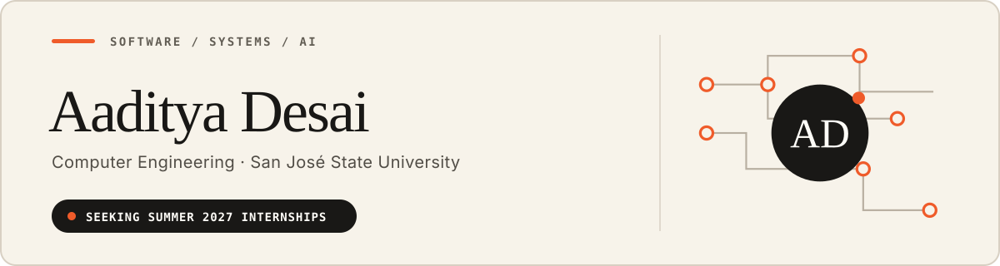

  

  &nbsp;&nbsp;&nbsp;
  &nbsp;&nbsp;&nbsp;
  &nbsp;&nbsp;&nbsp;
  &nbsp;&nbsp;&nbsp;
  

Computer Engineering student at San José State University (expected May 2028), minoring in AI. I've built a programming language with a register VM and an ARM64 JIT, led the software on an on-device navigation aid with Infineon, and I'm a TA for SJSU's Introduction to Engineering.

## Experience

- **Research Intern and Technical Lead, Infineon Technologies** (with De Anza College) · Apr to Jun 2026 
  Software lead on [VisionAssist](https://github.com/aadityad12/Vision-Assist), a team of five. Owned the vision pipeline, distance estimation, audio output, and web layer.
- **Teaching Assistant, ENGR 10: Introduction to Engineering, San José State University** · Aug 2026 to present 
  Two weekly lab sections of 30 students. Guides teams through soldering an IR receiver board and building and programming a VEX robot that finds infrared beacons.
- **Teaching Assistant and Computer Science Tutor, De Anza College** · Jan to Dec 2025 
  TA for x86 assembly and two C++ courses; tutored C++, MASM, Python, and data structures, mostly for first-time programmers.

## Selected work

### 01 / [Rung](https://github.com/aadityad12/rung)

**The Problem:** Every explanation of how interpreters get fast lists the same techniques: bytecode, register machines, NaN-boxed values, JITs. Few of them measure what each one is actually worth.

**The Solution:** Rung is a small language I built five times over in C++20: a tree-walker, a stack VM, a register VM, a baseline ARM64 JIT with a hand-written encoder verified against the LLVM assembler, and a JIT that compiles on a background thread. Each rung adds one change, and all engines must print byte-identical output. The interpreter foundations follow *Crafting Interpreters* and Lua 5.0; the optimization experiments, the JIT, background compilation, and the measurement pipeline extend them.

The stack VM runs at 1.30x to 4.99x the speed of the tree-walker. The JIT compiles functions in two of the six benchmarks, and in one interleaved session it ran `fib` 4.54x faster than the optimized register VM (13.37 ms to 2.94 ms). NaN-boxing made every benchmark slower, and that result stays in the table. Testing covers 529 conformance programs on every engine, ASan, UBSan, TSan, libFuzzer on the front end, and CI on macOS ARM64, Linux ARM64, and Linux x86-64.

  <strong>Tech Stack:</strong>&nbsp;&nbsp;
  &nbsp;
  &nbsp;
  &nbsp;
  &nbsp;
  

---

### 02 / [VisionAssist](https://github.com/aadityad12/Vision-Assist)

**The Problem:** Someone walking a sidewalk without sight needs to know what is ahead and how far away it is, without relying on a phone, the cloud, or a signal.

**The Solution:** VisionAssist is a head-mounted Raspberry Pi 5 and camera that detects obstacles, estimates their distance, and speaks through Bluetooth earbuds, fully on-device. It was built with Infineon Technologies through De Anza College, and I was the software lead. I built the pipeline: YOLOv8n detection on the Pi's CPU at about 200 ms per frame, distance from bounding-box height, risk-ranked announcements in feet and steps, and offline Piper speech, running as a systemd service that boots headless. I also evaluated Infineon's BGT60TR13C 60 GHz radar on a PSoC 6 AI Kit, traced why camera-radar fusion wasn't feasible in one quarter (antenna leakage at close range, about 175 cm of usable range, and no way to tell which object a reflection came from), cut it, and wrote up the findings. We demoed the finished device to the Infineon sponsors.

  <strong>Tech Stack:</strong>&nbsp;&nbsp;
  &nbsp;
  &nbsp;
  &nbsp;
  &nbsp;
  

---

### 03 / [OSS Scout](https://github.com/aadityad12/oss-scout) · [Contributions](https://oss.aadityad.dev)

**The Problem:** Finding a good open-source issue means searching across many projects, and automating it the obvious way adds to the low-effort, machine-generated PRs maintainers are already buried in.

**The Solution:** OSS Scout automates the search and preparation and leaves the decisions to me. A nightly scan on GitHub Actions ranks open issues by how friendly each project is to outside contributors, measured from its last 300 closed PRs, and reads each project's contribution and AI policies. A scheduled Claude Code routine prepares at most one tested draft a night for review on a private Cloudflare dashboard, and nothing is posted without my one tap. The unattended routine never sees the token that can open PRs or post comments; that token lives in the private data repo's secrets and is used only by the workflow my tap starts. A hook also rejects common GitHub write commands as a second layer. About 278 pytest tests cover the scanner, policy detection, and the guard.

  <strong>Tech Stack:</strong>&nbsp;&nbsp;
  &nbsp;
  &nbsp;
  &nbsp;
  

---

### 04 / [Accordion](https://github.com/a-Fig/accordion) · [Live site](https://get-accordion.dev) · [npm](https://www.npmjs.com/package/@a-fig/accordion)

**The Problem:** Long coding sessions eventually fill an agent's context window. The usual fix is to compress everything into one summary, which can remove details the agent needs later.

**The Solution:** Accordion treats the context window as reversible blocks that can be folded, unfolded, and pinned, with a context map that shows exactly what the agent sees. A team of four developed it through June 2026, and it won The Token Company sponsor track at the UC Berkeley AI Hackathon 2026. I built the conductor's health and evaluation layer, including a harness that compares folding against naive compaction, ported the conductor onto Accordion's fold, replace, and group contract, added a cross-encoder rerank stage, and built the conductor activity dashboard.

  <strong>Tech Stack:</strong>&nbsp;&nbsp;
  &nbsp;
  &nbsp;
  &nbsp;
  

---

### 05 / [ApexTracker](https://github.com/aadityad12/Apex-Tracker)

**The Problem:** Budgets, study time, reminders, notes, screen time, and reading lists often end up in separate apps, each with its own account and cloud dependency.

**The Solution:** ApexTracker puts those workflows in one offline-first Android app that I use every day. Room is the single source of truth, with 15 hand-written schema migrations, SQLCipher encryption under an Android Keystore key, and optional Firestore sync after sign-in. It includes biometric locks, exact alarms that survive reboot, five home-screen widgets, and on-device receipt scanning with ML Kit. About 525 unit tests cover the logic pulled out of the ViewModels.

  <strong>Tech Stack:</strong>&nbsp;&nbsp;
  &nbsp;
  &nbsp;
  &nbsp;
  

---

### 06 / [GazeBoard](https://github.com/aadityad12/GazeBoard)

**The Problem:** Someone who can't speak or use their hands needs a way to communicate that doesn't require dedicated hardware or send continuous video of their face to a server.

**The Solution:** GazeBoard turns a Snapdragon SM8750 Android phone into an offline gaze-to-speech board. It crops one eye, runs Qualcomm's EyeGaze model on the Snapdragon Hexagon NPU through LiteRT, and speaks the tile the user dwells on. The app declares only the camera permission. We built it at the Qualcomm × Google LiteRT Developer Hackathon, and I built the NPU-only inference path (an error screen instead of a silent CPU fallback), the on-screen debug overlay, and the recalibration flow, and later rewrote the docs with validation and limitations sections.

  <strong>Tech Stack:</strong>&nbsp;&nbsp;
  &nbsp;
  &nbsp;
  &nbsp;
  

---

### More projects

- **[Temper](https://github.com/aadityad12/Temper)**: Compares an AI agent's harness against a bare-model baseline to find where its prompt, skills, or tools make it worse, then patches and re-evaluates. I built the local evaluation harness, the FastAPI service, and the patch loop. AI Engineer World's Fair Hackathon 2026.
- **[Clear Dispatch](https://github.com/aadityad12/Clear-Dispatch)**: Emergency-dispatch simulation with a four-stage pipeline where heavy resources stay blocked until a dispatcher approves them. I built the backend's first full version: the four pipeline stages, the FastAPI routers, the WebSocket hub, and the call simulator. HackDavis 2026.
- **[Echo](https://github.com/aadityad12/Echo)**: A Flutter prototype that receives, stores, and relays emergency alerts between nearby phones over Bluetooth Low Energy, with no internet. I ported it to Flutter, including the native Android and iOS GATT servers and chunked transfer, and built the Raspberry Pi relay. Hack for Humanity 2026.

## Certifications

- AWS Certified Cloud Practitioner · Amazon Web Services · 2026
- [Claude Code in Action](https://verify.skilljar.com/c/yyicktpq778z), Introduction to Model Context Protocol, and Model Context Protocol: Advanced Topics · Anthropic · 2026
- Oracle Cloud Infrastructure Generative AI Professional · Oracle · 2024
