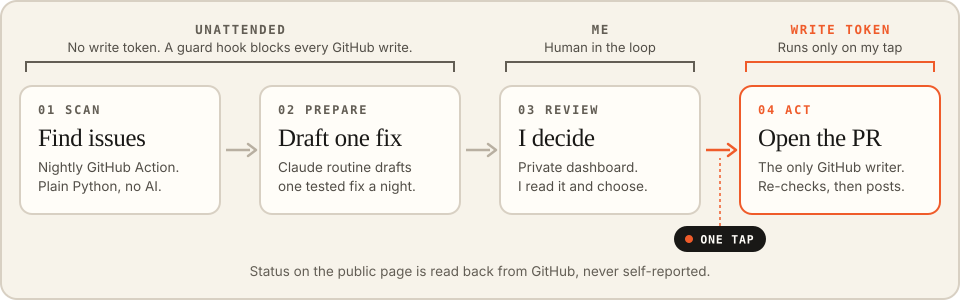

  <picture>
    <source media="(prefers-color-scheme: dark)" srcset="./assets/profile-header-dark.svg">
    
  </picture>

  &nbsp;&nbsp;&nbsp;
  &nbsp;&nbsp;&nbsp;
  &nbsp;&nbsp;&nbsp;
  &nbsp;&nbsp;&nbsp;
  

I'm Aadi, a Computer Engineering student at San José State University (expected May 2028, AI minor). I build at every layer, from bare-metal firmware and a JIT compiler up to AI agents and an Android app I use every day, and I like work I can measure.

If you came here from my résumé, this page is the long version: what each project does, how it's built, what I measured, and what still doesn't work. I'm looking for a **Summer 2027 internship** (May to August) in software, embedded and firmware, AI/ML, or infrastructure.

### Where to look

| If you're hiring for | Start with |
| :-- | :-- |
| Systems, compilers, C++ | [Rung](#rung) |
| Embedded, firmware, hardware | [Alta](#alta) · [VisionAssist](#visionassist) |
| AI agents and developer tooling | [Accordion](#accordion) · [Alta](#alta) · [Sisyphus](#more-projects) · [Temper](#more-projects) |
| Mobile and Android | [ApexTracker](#apextracker) · [GazeBoard](#more-projects) |
| Backend, infrastructure, security | [OSS Scout](#oss-scout) · [Clear Dispatch](#more-projects) |

## Featured projects

### Rung

**A small programming language built five times over, to measure what each classic interpreter speed-up is actually worth.**

Solo · Sep to Oct 2026 · [Code](https://github.com/aadityad12/rung)

  

Every explanation of how Python, Lua, or JavaScript get fast lists the same techniques: bytecode, register machines, 8-byte values, JITs. I wanted to know how much each one helps, measured rather than claimed, so I built each one myself.

**How it's built**

- One shared front end (lexer, parser, resolver) feeds five engines: a tree-walker, a stack bytecode VM, a register VM, a baseline ARM64 JIT, and a JIT that compiles on a background thread. They share one runtime and garbage collector, and all five must print byte-identical output.
- The engines form a ladder of nine rungs. Each rung is the previous one plus exactly one change: computed-goto dispatch, NaN-boxed values, a register machine, superinstructions, inline caching, constant folding, and finally the JIT.
- The JIT has no code-generation library. I wrote the ARM64 encoder by hand and verified it byte for byte against the LLVM assembler. When a type check fails, compiled code bails out mid-function and resumes in the VM.
- The interpreter foundations follow *Crafting Interpreters* and Lua 5.0. The optimization ladder, the JIT, background compilation, and the measurement pipeline extend them.

**What I measured** (Apple M1 Pro, median per-call time; CI fails if the tables in the repo drift from the recorded runs)

  

- The stack VM runs at 1.30x to 4.99x the speed of the tree-walker.
- The register VM does the sieve benchmark's work in a third of the stack VM's instructions.
- The JIT compiles functions in two of the six benchmarks. On `fib` it runs 4.54x faster than the optimized register VM (13.37 ms to 2.94 ms).
- NaN-boxing made every benchmark slower, even though it halved values from 16 to 8 bytes. I haven't explained why yet, and the result stays in the table.
- Superinstructions cut the string benchmark's dispatched instructions by 36.5% and barely changed its time.

<strong>Three bugs worth telling, and how it's tested</strong>

 

- **A crash in about 5% of runs.** UBSan reads 8 bytes before an indirect-call target. JIT code placed at the very start of a mapped page made that read hit unmapped memory on Linux ARM64. I found it by looping the test 300 to 600 times in CI and fixed it with 16 zero bytes before the code.
- **A sanitizer that couldn't see the bug.** TSan on macOS missed a deliberately broken thread handoff when the code was copied with `memcpy`. Switching to plain 4-byte stores made it detectable. A clean sanitizer run only counts if the sanitizer can see the accesses.
- **A stack overflow from `1+1+...+1`.** The fuzzer found that long flat chains overflowed the native stack. Chains over 1000 links are now a compile error, and chains are destroyed without native recursion.

Testing runs in five layers: a conformance suite on every engine (also with garbage collection forced on every allocation), unit tests including the encoder checked against LLVM, ASan, UBSan and TSan builds with warnings as errors, a libFuzzer harness on the front end, and CI on macOS ARM64, Linux ARM64, and Linux x86-64.

Limits: the JIT is narrow (integer arithmetic, comparisons, jumps, and array access; no calls, floats, or strings) and ARM64-only, and all numbers come from one machine.

  <strong>Tech Stack:</strong>&nbsp;&nbsp;
  &nbsp;
  &nbsp;
  &nbsp;
  &nbsp;
  

---

### Alta

**A voice-driven lab teaching assistant for intro electronics. It measures the student's breadboard with real probes and walks them to the fault instead of handing over the answer.**

Team of four · Cal Hacks 13.0, Oct 2026 (36 hours) · [Code](https://github.com/aadityad12/Alta)

  

I TA two intro engineering lab sections at SJSU. One TA covers a room, and most students get stuck on the same few mistakes: an LED in backwards, the wrong resistor, a ground wire that never reached the rail. A student waits ten minutes for a TA who finds it in thirty seconds, often by fixing it for them, so the student learns nothing. Alta is the TA already at the bench, and it teaches from a real voltage reading, not from a photo or the student's description.

**How it works**

- **Probe pod.** An Arduino Uno (ATmega328P) in a 3D-printed dock with four color-coded probes, a push-to-talk button, and a status LED. It powers the student's board and shares its ground.
- **Firmware.** Bare-metal C on the ATmega328P registers, with no Arduino libraries: an interrupt-driven ADC driver, a 115200-baud UART with ring buffers so printing never stalls the loop, and a 1 ms timer tick for debouncing. It samples each probe about 1,200 times a second and sends one JSON line every 50 ms.
- **Agent.** Claude Opus 5.5 with tools that act on the bench: ask for a probe at one hole, read the probes, highlight a part, record a diagnosis. Its core rule is to measure before diagnosing. A four-step hint ladder gives away the fix only after the student has asked twice, failed three times, or stayed stuck.
- **Probe monitor.** When a reading settles, or jumps into the expected range because the student just fixed the circuit, the agent speaks with no button press and confirms the fix with the new reading.
- **Voice.** Cartesia speech-to-text and streaming text-to-speech, spoken sentence by sentence while the agent is still writing. Having the agent write its spoken reply before its tool calls cut the time to its first words from 4.7 s to 1.9 s.
- **Labs as data.** Each lab is one `lab.yaml` (parts, expected voltages, known faults and their hints), so adding a lab means writing a file, not code.

**Results**

- On the real board, 3 of 3 timed runs found and fixed the fault with no errors: an LED in backwards, a missing ground wire, and a 10 kΩ resistor where a 220 Ω belonged.
- Alta starts speaking a median 2.57 s after the student releases the talk button, and reacts to a probe with no button press in a median 1.75 s.
- In simulation (7 faults, 3 runs each, every reply graded by a second model) it named the right fault in 42 of 42 runs and gave the fix away early in 1.
- The firmware is tested without hardware: `make check` runs the real firmware binary in the simavr simulator against the server's real serial bridge, with 25 checks and a 60 s soak. The server has 195 tests.

**My focus:** the probe pod hardware and its firmware, the lab definitions, the probe monitor, and the camera overlay engine.

**Limits:** the camera overlay can't place highlights reliably on a real board, so it ships off by default and Alta teaches from probe readings. The second lab passes simulation only. It needs the internet for Claude and Cartesia.

  <strong>Tech Stack:</strong>&nbsp;&nbsp;
  &nbsp;
  &nbsp;
  &nbsp;
  &nbsp;
  &nbsp;
  

---

### VisionAssist

**A head-mounted Raspberry Pi 5 and camera that tell someone who can't see what is ahead and how far away it is, with no phone, cloud, or internet.**

Software lead, team of five · Built with Infineon Technologies through De Anza College · Apr to Jun 2026 · [Code](https://github.com/aadityad12/Vision-Assist)

  

Someone walking a sidewalk without sight needs to know what is in the way and how many steps off it is, and they need that to keep working where there is no signal. I led the software: the vision pipeline, distance estimation, audio, and the web layer.

**How it works** (one Python process, about 5 frames a second)

- **Detection.** YOLOv8n on the Pi 5's CPU at about 200 ms per frame.
- **Distance.** Estimated from bounding-box height: real height × focal length ÷ box height. I rejected ground-plane projection because it needs the camera's pitch, and a head tilts by about ±15 degrees.
- **What to say.** Only the single riskiest, closest object is announced, in feet and in steps, and it repeats only on a change or after a 3 s cooldown. The rules are hand-written rather than learned, so they can be inspected.
- **Speech.** Piper text-to-speech, fully offline, to Bluetooth earbuds.
- **Deployment.** A systemd service that boots headless on power-up, plus a phone web app as a second output path.

**The radar I cut.** Infineon gave us a 60 GHz radar (BGT60TR13C on a PSoC 6 AI Kit) to build around. After several weeks I traced why camera-radar fusion wasn't feasible in one quarter: antenna leakage and floor reflections produced phantom obstacles at close range, usable range topped out around 175 cm, and a radar return doesn't say which object it came from. I cut it and wrote up the findings for Infineon.

**Result:** a working device, demoed to the Infineon sponsors. **Limits:** distance overestimates inside about 4 ft, the focal length was tuned by hand rather than calibrated, and it can't detect stairs or drop-offs.

  <strong>Tech Stack:</strong>&nbsp;&nbsp;
  &nbsp;
  &nbsp;
  &nbsp;
  &nbsp;
  

---

### Accordion

**A context manager for AI coding agents. It folds away material that isn't carrying weight, reversibly and in plain sight.**

Team of four · Winner, The Token Company sponsor track, UC Berkeley AI Hackathon 2026 · 240+ stars · [Code](https://github.com/a-Fig/accordion) · [Site](https://get-accordion.dev) · [npm](https://www.npmjs.com/package/@a-fig/accordion)

  

Coding agents get worse as their context fills with material that no longer matters. The usual fix compresses everything into one summary, which loses details the agent needs later. Accordion's premise is that hiding should be reversible and inspectable.

**How it works**

- A context map shows one square per block of the agent's context, sized by token weight and colored by kind. Folding changes only what the agent sees, and a protected tail is never folded.
- A conductor is the policy that decides what to fold. Conductors are interchangeable, and a human or agent override always wins.
- It ships as an agent extension plus a Tauri and SvelteKit desktop app.

**My focus: the conductor**

- A three-stage relevance pipeline that decides what to bring back: keyword scoring, bi-encoder retrieval, then a cross-encoder rerank.
- A self-calibrating fold target that holds context usage in a 0.60 to 0.92 band, with a folding budget that survives reconnects.
- A health and evaluation layer: health metrics, a folding evaluator, a session evaluator, and a harness that compares folding against naive compaction.
- An activity dashboard showing the health verdict, calibration events, and each fold decision.

**Result:** on SlopCodeBench at a 100K budget, Accordion with its attention-based conductor solved 5 of 6 problems against 2 of 6 for naive compaction. That is a single hackathon-scale run, not a published benchmark. The project site has passed 10,000 visits. I consider it my most technically challenging project, and I picked it back up in November 2026 to make it work without a host agent.

  <strong>Tech Stack:</strong>&nbsp;&nbsp;
  &nbsp;
  &nbsp;
  &nbsp;
  

---

### ApexTracker

**A private, offline-first Android app that replaced my sticky notes, three reminder apps, a calendar, and my budget spreadsheets. I use it every day.**

Solo · Jan 2026 to present · [Code](https://github.com/aadityad12/Apex-Tracker)

  &nbsp;
  &nbsp;
  &nbsp;
  

It started as a deliberately ordinary project to build the habit of building, and stopped being an exercise when I found myself reaching for it instead of the mess. One rule decides what ships: would I open this every single day?

**What it does**

- A dashboard heatmap that scores each day by the share of goals met. Goals can be automatic, evaluated from the other trackers ("screen time under 6h", "study 2h").
- Budget with category limits, subscriptions, CSV import and export, and receipt capture. A study timer, per-app screen-time limits, reminders with exact alarms that survive a reboot, notes, and a research-paper reading queue.
- Five home-screen widgets, including a startable study timer and a quick-add expense.

**How it's built**

- Room is the single source of truth, with 15 hand-written schema migrations.
- The database is encrypted at rest with SQLCipher under an Android Keystore key, and a biometric lock gates Budget and Notes.
- It builds and runs fully offline. Sync through Firebase Auth and Firestore is optional.
- Receipt capture uses on-device ML Kit text recognition through the photo picker, so it needs no camera permission and uploads nothing.
- About 525 unit tests cover the logic pulled out of the ViewModels, alongside Compose screenshot tests.

<strong>Bugs worth telling</strong>

 

- **The receipt parser passed every test, then filled in the shop's street number on a real phone.** On a device, labels and amounts come back as separate blocks, and "TOTAL" never shares a line with its figure. It isn't done until it's run on a device.
- **SQLCipher took four rounds:** a native library that doesn't load itself, open flags that silently carried into `ATTACH`, two key formats that look identical and aren't, and a memory-locking default that stalled the app.
- **Study sessions past midnight landed on the wrong day** because the widget and the in-app button banked time separately. They now share one file.

  <strong>Tech Stack:</strong>&nbsp;&nbsp;
  &nbsp;
  &nbsp;
  &nbsp;
  

---

### OSS Scout

**A nightly scout for open-source contributions that keeps a human in charge. Nothing is posted without my one tap.**

Solo · Sep to Oct 2026 · In daily use · [Code](https://github.com/aadityad12/oss-scout) · [My contributions](https://oss.aadityad.dev)

  <picture>
    <source media="(prefers-color-scheme: dark)" srcset="./assets/oss-scout-flow-dark.svg">
    
  </picture>

Maintainers are buried in low-effort, machine-generated pull requests. OSS Scout automates the tedious parts (search, triage, reading unfamiliar code) and leaves the trust-building to a person: deciding, reading the change, and defending it in review.

**How it works**

- **Scan.** A nightly GitHub Action in plain Python, with no AI, finds open issues and ranks them by how each project treats outside contributors, measured from its last 300 closed pull requests: merge rate, days to merge, and time to a maintainer's first reply. It also reads each project's contribution and AI policies.
- **Prepare.** A scheduled Claude routine prepares at most one tested draft fix a night, with the pull-request text and a plain-English explanation.
- **Review.** I read it on a private dashboard served by a Cloudflare Worker behind Cloudflare Access.
- **Act.** One tap starts the only workflow that can write to GitHub. It re-checks the issue, the project's rules, and the branch before it posts.

**Why the unattended part can't post**

- The routine never sees the token that can open pull requests. That token lives in a private repo's secrets and is used only by the workflow my tap starts.
- A Claude Code hook blocks every GitHub write command as a second layer, with 37 tests of its own.
- Text written by strangers is treated as data: the prompt says so, and the dashboard escapes it.
- About 278 tests cover the scanner, policy detection, the act step, and the guard.

  <strong>Tech Stack:</strong>&nbsp;&nbsp;
  &nbsp;
  &nbsp;
  &nbsp;
  

## More projects

**[Sisyphus](https://github.com/aadityad12/Sisyphus)** · Top 6 finalist, AIE Code Summit 2026 Hackathon · Team of four 
A self-improving video editing system. A Creator agent edits short-form videos, a Reviewer approves each one or sends it back with reasons, and an Auditor turns failures into versioned changes to the agents' skills and tools. A change is kept only if it wins a shadow A/B test on held-out footage; otherwise it is rolled back. My focus was the Reviewer and the Auditor. Python engine, React and Tauri desktop app.

**[GazeBoard](https://github.com/aadityad12/GazeBoard)** · Qualcomm × Google LiteRT Developer Hackathon 2026 · Team of three 
An offline gaze-to-speech board for someone who can't speak or use their hands. It crops one eye, runs Qualcomm's EyeGaze model on the Snapdragon Hexagon NPU through LiteRT, and speaks the tile the user dwells on. The app declares only the camera permission, because the camera points at a disabled user's face all day. My focus was the NPU-only inference path (an error screen instead of a silent CPU fallback), the debug overlay, and recalibration. Kotlin and Jetpack Compose.

**[Temper](https://github.com/aadityad12/Temper)** · AI Engineer World's Fair Hackathon 2026 · Team of three 
An evaluator for AI agent harnesses. It asks the same questions of a bare model and of the model wrapped in its system prompt, skills, and tools; where the wrapped version scores lower, the harness is the cause. A patch loop then rewrites the failing files and re-evaluates. My focus was the API contract, the FastAPI evaluation service, and the patch loop. A deterministic offline mode runs the whole loop with no API keys. Python, FastAPI, React.

**[Clear Dispatch](https://github.com/aadityad12/Clear-Dispatch)** · HackDavis 2026 · Team of three 
A wildfire-surge emergency-dispatch simulation built around one question: where does automation belong when errors cost lives? A four-stage pipeline triages synthetic 911 calls and assigns units, but heavy assets such as air tankers stay blocked until a dispatcher confirms. I built the backend: the four pipeline stages, the FastAPI routers, the WebSocket hub, and the call simulator. Python, FastAPI, React, Claude Haiku.

**[Echo](https://github.com/aadityad12/Echo)** · Hack for Humanity 2026 · Team of three 
A Flutter app that receives, stores, and relays emergency alerts between nearby phones over Bluetooth Low Energy, for when the network fails during the disaster it should be warning about. Each phone is both a BLE central and a peripheral, alerts hop from phone to phone with a custom chunking protocol, and they can be read aloud or translated on-device into 22 languages. My focus was the port from native Kotlin to Flutter, the BLE transport, and a Raspberry Pi relay. Flutter, Kotlin, Swift, Python.

## Recognition

- **Sponsor Track Winner** (The Token Company), UC Berkeley AI Hackathon 2026, for Accordion
- **Top 6 finalist**, AIE Code Summit 2026 Hackathon, for Sisyphus
- **2nd place**, DA Hacks 3.5, for [ClassPath AI](https://devpost.com/software/class-path-ai)
- **Most Valuable Peer**, HackStorm 2.0, peer-nominated for cross-team technical contribution
- **Top 10 at site**, Division 2, ICPC 2025 Regionals

## Get in touch

I'm looking for a Summer 2027 internship and I'm open to relocating. The fastest way to reach me is [email](mailto:aaditya.d.desai@gmail.com) or [LinkedIn](https://www.linkedin.com/in/aaditya-desai-12d). My résumé is [here](https://aadityad.dev/Aaditya_Desai_Portfolio_Resume.pdf), and there is more at [aadityad.dev](https://aadityad.dev).

 

  
   
  This koi is redrawn every night from my public GitHub activity by <a href="https://github.com/yalongwastaken/git-koi">git-koi</a>. My languages color it and my contributions grow it.

